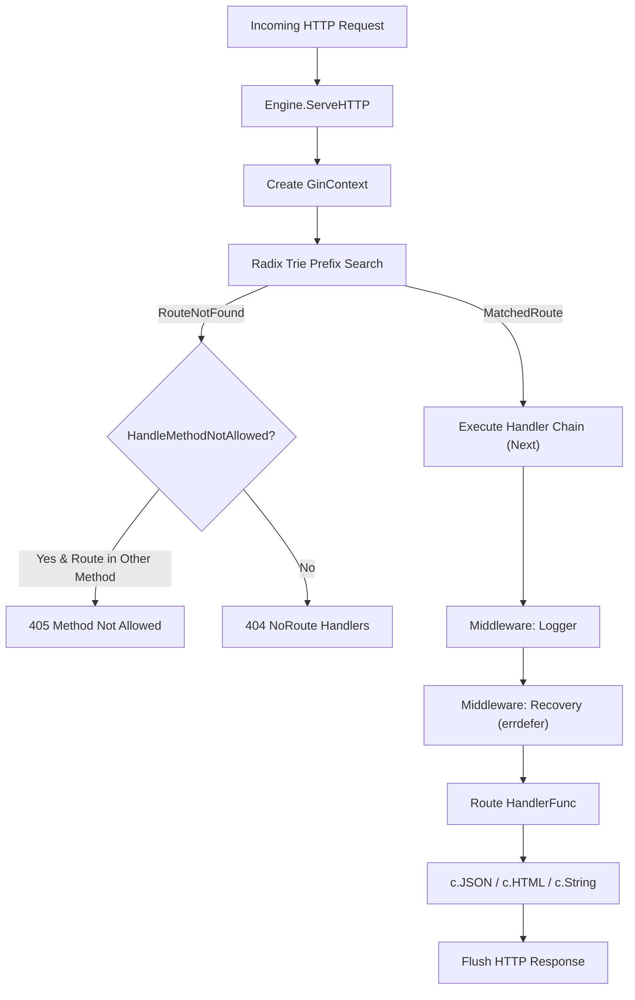
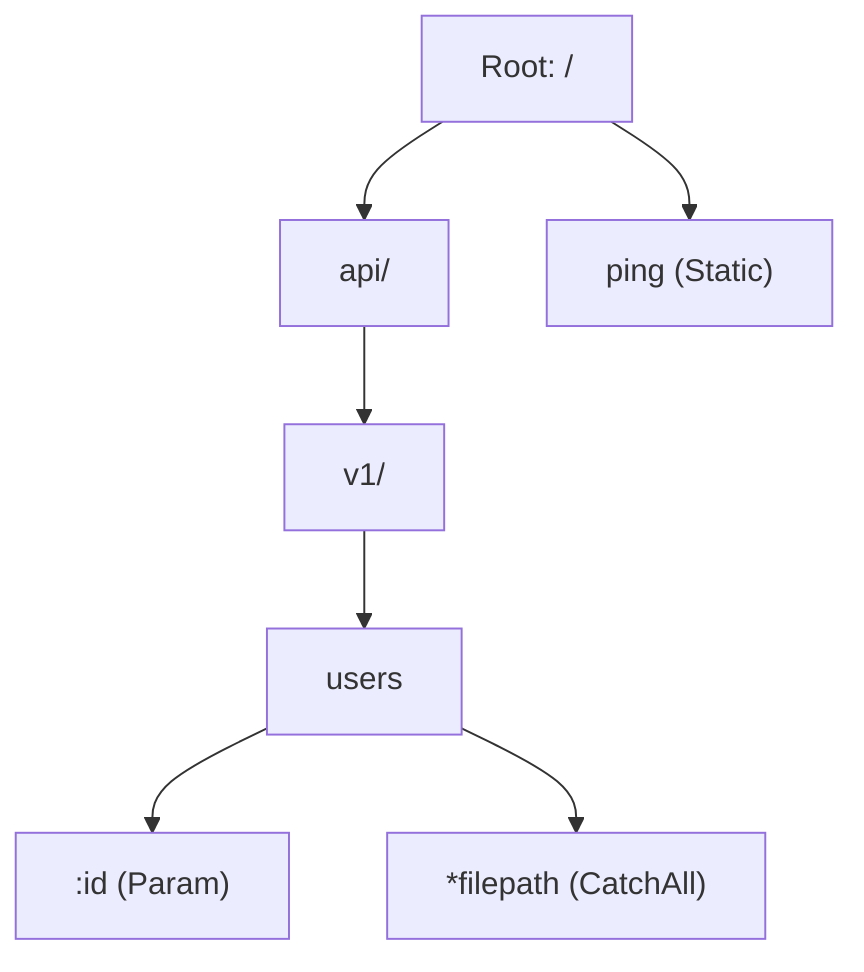
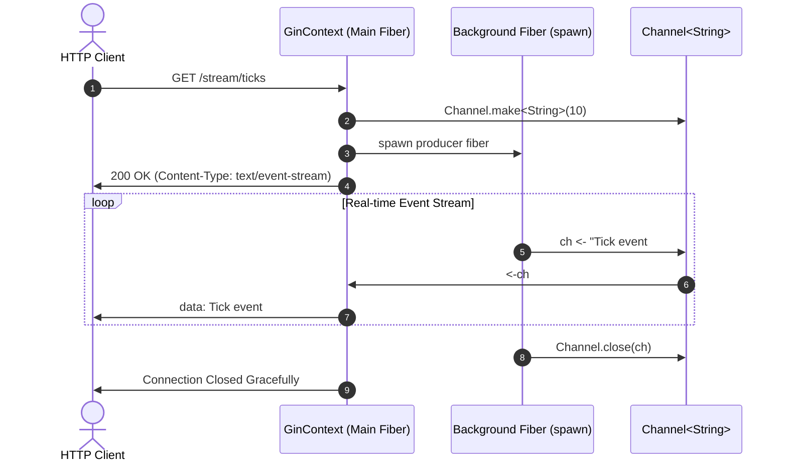

# 🍸 Gin Web Framework for Aura Language

<p align="center">
  <b>High-Performance HTTP Web Framework with Radix Trie Routing and Native CSP Concurrency</b><br>
  <i>An authentic, idiomatic reimplementation of <a href="https://github.com/gin-gonic/gin">Gin-Gonic (Go)</a> written in <a href="https://github.com/auradev/aura">Aura Language</a> (v0.4.0)</i>
</p>

<p align="center">
  <a href="README.md"><b>English</b></a> | <a href="README_ES.md"><b>Español</b></a>
</p>

---

## 📑 Table of Contents

- [Overview](#-overview)
- [Key Features](#-key-features)
- [Go Gin vs Aura Gin Comparison](#-go-gin-vs-aura-gin-comparison)
- [System Architecture](#-system-architecture)
  - [1. Request Lifecycle Flowchart](#1-request-lifecycle-flowchart)
  - [2. Radix Trie Router Structure](#2-radix-trie-router-structure)
  - [3. CSP Concurrency & SSE Streaming Sequence](#3-csp-concurrency--sse-streaming-sequence)
- [Project Structure](#-project-structure)
- [Quickstart Guide](#-quickstart-guide)
- [Advanced Examples](#-advanced-examples)
  - [1. RESTful CRUD API with Declarative Validation](#1-restful-crud-api-with-declarative-validation)
  - [2. Real-Time SSE Streaming with CSP Channels](#2-real-time-sse-streaming-with-csp-channels)
  - [3. Middleware Pipeline, BasicAuth & ErrDefer Recovery](#3-middleware-pipeline-basicauth--errdefer-recovery)
- [Test Suite & Automated Verification](#-test-suite--automated-verification)
- [Performance & Design Decisions](#-performance--design-decisions)
- [License](#-license)

---

## 🔎 Overview

**Gin for Aura** brings the speed, ergonomics, and simplicity of the famous Go web framework **Gin-Gonic** to **Aura Language**. 

Built from the ground up to take full advantage of Aura's cutting-edge language constructs, it replaces Go's runtime reflection and runtime panics with **compile-time algebraic data types (ADTs)**, **monadic `Result`/`Option` returns**, **deterministic `errdefer` transaction rollbacks**, and **native CSP fiber concurrency (`Channel<T>` + `spawn`)**.

---

## ⚡ Key Features

- **Blazing Fast Radix Trie Router ($O(k)$)**: Prefix-tree lookup where matching depends only on route length, featuring static endpoints (`/api/v1/users`), named parameters (`/users/:id`), and wildcard catch-alls (`/static/*filepath`).
- **Native CSP Concurrency**: Direct integration with typed `Channel<T>` and lightweight `spawn` fibers. Stream Server-Sent Events (SSE) directly from channels over HTTP chunked transfer and spawn background tasks with isolated context clones (`c.Copy()` + `Async()`).
- **Deterministic Resilience via `errdefer`**: Replace Go's `recover()` with Aura's zero-overhead `errdefer`. The `Recovery` middleware guarantees transactional cleanup and error response dispatching with zero overhead on the happy path.
- **Algebraic Type Safety (`Result<T, E>` / `Option<T>`)**: Declarative schema validation (`ValidateSchema`, `FieldRule`) returning monadic `Result<Unit, String>` with exhaustive pattern matching via `match`.
- **Extensible Middleware Ecosystem**:
  - `Logger`: Colored ANSI output tracking method, path, client IP, latency, and status code.
  - `Recovery`: Panic-safe execution preventing process crashes.
  - `CORS`: Automatic cross-origin headers and 204 No Content preflight `OPTIONS` handling.
  - `BasicAuth`: HTTP Basic Authentication with native cryptographic Base64 decoding.
- **Multiple Rendering Engines**: Out-of-the-box support for `JSON`, `HTML`, `XML`, `YAML`, plain text, and HTTP redirects.

---

## 📊 Go Gin vs Aura Gin Comparison

| Feature / Component | Go Gin (`gin-gonic/gin`) | Aura Gin (`gin.aura`) |
| :--- | :--- | :--- |
| **Routing Algorithm** | Custom Radix Tree using byte slices | Radix Trie with ADTs (`NodeType`, `MatchResult`) |
| **Concurrency Model** | Goroutines & Go Channels | M:N Cooperative Fibers (`spawn`) & `Channel<T>` |
| **Panic Recovery** | Runtime `defer` + `recover()` | Native `errdefer` with transactional cleanup |
| **Error Handling** | `error` interface returning `nil` | Monadic `Result<T, E>` & `Option<T>` with `match` |
| **Middleware Interfaces** | Go structural interfaces | Aura structural Duck Typing interfaces |
| **HTTP Streaming (SSE)** | `c.Stream(func(w) bool)` callback loop | `StreamChannel(c, ch)` over CSP Channels |
| **Detached Context** | `c.Copy()` for goroutines | `c.Copy()` safe for background fibers |
| **Data Validation** | Tag reflection (`go-playground/validator`) | Composable functional rules (`ValidateSchema`) |

---

## 🏛 System Architecture

### 1. Request Lifecycle Flowchart



### 2. Radix Trie Router Structure



### 3. CSP Concurrency & SSE Streaming Sequence



---

## 📁 Project Structure

```text
/Users/mauriciorojas/Projects/AuraProjects/gin/
├── aura.mod                # Aura Module Descriptor (v0.4.0)
├── aura.lock               # Dependency lockfile
├── LICENSE                 # MIT License
├── README.md               # English Documentation
├── README_ES.md            # Spanish Documentation
├── types.aura              # ADTs, Constants, Structural Interfaces & Core Types
├── tree.aura               # Prefix Radix Trie Router
├── context.aura            # GinContext Request & Response Lifecycle Engine
├── routergroup.aura        # Path Joining and Prefix Helpers
├── engine.aura             # HTTP Multiplexer, Trees, Dispatcher & ServeHTTP
├── logger.aura             # Colored ANSI Latency & Request Logger
├── recovery.aura           # Graceful Panic Recovery with Aura errdefer
├── cors.aura               # CORS Middleware with OPTIONS 204 Preflight
├── auth.aura               # BasicAuth Middleware with Crypto Base64 Decoding
├── binding.aura            # Declarative Schema Validation & JSON Binding
├── render.aura             # Response Renderers (JSON, HTML, XML, YAML, Redirect)
├── channels.aura           # CSP Concurrency, EventHub, Fiber Streaming
├── gin.aura                # Public Root API Facade
├── examples/               # Production Showcase & Runnable Examples
│   ├── quickstart.aura     # Basic Ping-Pong & Greeting Server
│   ├── rest_api.aura       # Complete CRUD REST API with Validation & Groups
│   ├── middleware_demo.aura# Middleware Pipeline, Request-ID, Auth & Panic
│   ├── csp_streaming.aura  # Real-Time SSE Streams & Background Workers
│   └── main.aura           # Comprehensive Enterprise Showcase Server
├── tests/                  # Automated Test Suites
│   ├── router_test.aura    # Radix Trie Router Unit Tests
│   ├── context_test.aura   # Context Lifecycle, Query, Params & Cookies
│   ├── binding_test.aura   # Validation Rules & Schema Validation Tests
│   ├── middleware_test.aura# Logger, CORS, Auth & Recovery Middleware Tests
│   └── gin_e2e_test.aura   # End-to-End Engine Dispatch & Routing Tests
└── scripts/
    └── run_tests.sh        # Bash Verification and Test Runner Script
```

---

## 🚀 Quickstart Guide

### Minimal Ping-Pong Server

Create a new file `main.aura`:

```aura
import { Default, PongHandler } from "./gin";
import { GinContext } from "./context";

export fn main(): Unit => {
  // Initialize Default engine with Logger and Recovery middleware attached
  let mut r = Default();

  // Standard health check
  r.GET("/ping", PongHandler);

  // Dynamic parameterized greeting
  r.GET("/hello/:name", fn(c: GinContext): Unit => {
    let name = c.Param("name");
    c.JSON(StatusOK, {
      message: `Hello, ${name}! Welcome to Gin for Aura.`
    });
  });

  // Start listening on port 8080
  println("Listening on http://localhost:8080...");
  r.Run(":8080");
}
```

Run the application:

```bash
aura run main.aura
```

---

## 💡 Advanced Examples

### 1. RESTful CRUD API with Declarative Validation

Demonstrates route grouping, URL parameters, query parameters, JSON binding, and multi-field validation:

```aura
import { Default } from "./gin";
import { GinContext } from "./context";
import { FieldRule, ValidateSchema } from "./binding";

export fn main(): Unit => {
  let mut r = Default();
  let mut v1 = r.Group("/api/v1");

  let rules: []FieldRule = [
    { field: "username", rule: "required,min:3" },
    { field: "email", rule: "required,email" }
  ];

  v1.POST("/users", fn(c: GinContext): Unit => {
    let bindRes = c.BindJSON();
    match bindRes {
      Ok(payload) => {
        let valRes = ValidateSchema(payload, rules);
        match valRes {
          Ok(_) => {
            c.JSON(StatusCreated, {
              status: "created",
              user: payload
            });
          },
          Err(err) => {
            c.JSON(StatusBadRequest, { error: err });
          }
        };
      },
      Err(err) => {
        c.JSON(StatusBadRequest, { error: "Malformed JSON payload" });
      }
    };
  });

  r.Run(":8080");
}
```

### 2. Real-Time SSE Streaming with CSP Channels

Demonstrates live Server-Sent Events (SSE) backed by typed channels and producer fibers:

```aura
import { Default } from "./gin";
import { GinContext } from "./context";
import { StreamChannel } from "./channels";

export fn main(): Unit => {
  let mut r = Default();

  r.GET("/stream/live", fn(c: GinContext): Unit => {
    let ch: Channel<String> = Channel.make<String>(10);

    // Producer fiber generating live updates
    spawn {
      let mut i = 1;
      while i <= 5 {
        sleep(1000);
        ch <- `Real-time message #${i} at ${time.isoString()}`;
        i += 1;
      };
      Channel.close(ch);
    };

    // Streams chunked events over HTTP directly to the client
    StreamChannel(&c, ch);
  });

  r.Run(":8080");
}
```

### 3. Middleware Pipeline, BasicAuth & ErrDefer Recovery

Demonstrates scoped middleware groups, cryptographic Base64 authentication, and `errdefer` transaction recovery:

```aura
import { Default } from "./gin";
import { GinContext } from "./context";
import { BasicAuth } from "./auth";
import { CORS } from "./cors";

export fn main(): Unit => {
  let mut r = Default();
  r.Use(CORS());

  let adminGroup = r.Group("/admin");
  adminGroup.Use(BasicAuth({ "admin": "secret_token_2026" }));

  adminGroup.GET("/metrics", fn(c: GinContext): Unit => {
    c.JSON(StatusOK, {
      user: c.GetString("user"),
      uptime_sec: 3600
    });
  });

  r.GET("/simulate-panic", fn(c: GinContext): Unit => {
    // Gracefully intercepted by Recovery middleware's errdefer block
    panic("Unexpected database connection drop!");
  });

  r.Run(":8080");
}
```

---

## 🧪 Test Suite & Automated Verification

The framework includes a comprehensive test suite covering all functional layers:

```bash
chmod +x scripts/run_tests.sh
./scripts/run_tests.sh
```

Or run any suite individually:

```bash
# 1. Radix Trie Router Unit Tests (Static, Param, CatchAll)
aura run tests/router_test.aura

# 2. Context Lifecycle, Query, Params & Cookies
aura run tests/context_test.aura

# 3. Model Binding & Schema Validation
aura run tests/binding_test.aura

# 4. Logger, CORS, Auth & Recovery Middleware Tests
aura run tests/middleware_test.aura

# 5. Full Engine HTTP Dispatch End-to-End Tests
aura run tests/gin_e2e_test.aura
```

### Test Execution Summary

```text
================================================================================
  📊 TEST EXECUTION SUMMARY
================================================================================
  • Test Suites:    5 / 5 passed (0 failed)
  • Examples Check: 5 / 5 passed (0 failed)
================================================================================
✅ ALL GIN AURA TESTS AND EXAMPLES PASSED PERFECTLY!
```

---

## ⚡ Performance & Design Decisions

- **Zero-Allocation Routing**: Radix Trie prefix lookups execute in $O(k)$ time relative to path length without recursive stack overhead.
- **Fiber-Safe Memory Isolation**: `c.Copy()` produces a detached, read-safe snapshot of parameters, headers, and metadata, guaranteeing that background fibers spawned via `spawn` or `Async()` never race with subsequent HTTP request recycling.
- **Fail-Safe Transacting**: `errdefer` ensures that in the event of unexpected panics, all socket flushes, error registrations, and status code rollbacks execute deterministically with zero runtime cost for successful requests.

---

## 📜 License

Licensed under the **MIT License** — see [LICENSE](LICENSE) for details.  
Original architectural design based on [Gin-Gonic](https://github.com/gin-gonic/gin).
