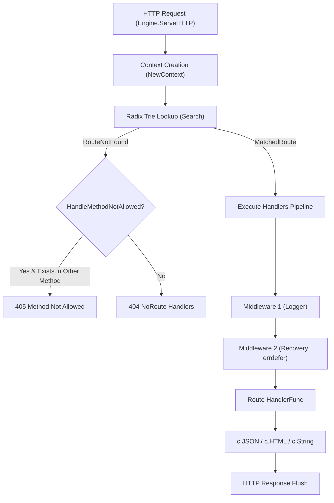
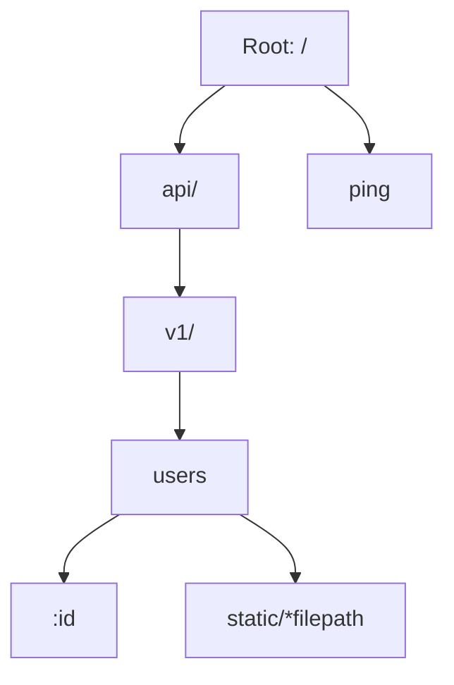
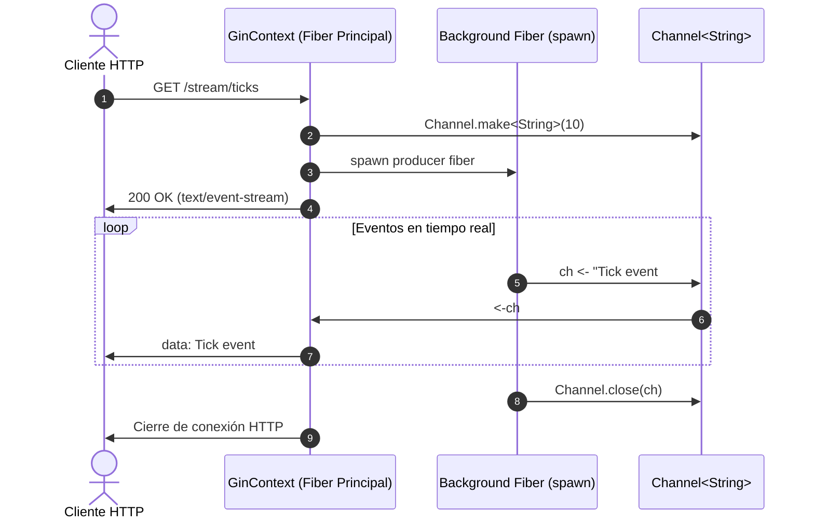

# 🍸 Gin Web Framework for Aura Language

<p align="center">
  <a href="README.md"><b>English</b></a> | <a href="README_ES.md"><b>Español</b></a>
</p>

> **Reimplementación integral y de alto rendimiento de [Gin-Gonic (Go)](https://github.com/gin-gonic/gin) en [Aura Language](https://github.com/auradev/aura) (v0.4.0)**, aprovechando todas sus características de última generación: enrutador Radix Trie optimizado, concurrencia CSP nativa (Fibras y Canales), recuperación de pánico con `errdefer`, tipado algebraico (`Result`/`Option`), duck typing estructural y streaming en tiempo real.

---


## 📑 Tabla de Contenidos / Table of Contents

- [Características Principales / Key Features](#-características-principales--key-features)
- [Comparativa: Go Gin vs Aura Gin / Comparison Matrix](#-comparativa-go-gin-vs-aura-gin)
- [Arquitectura del Sistema / System Architecture](#-arquitectura-del-sistema)
- [Estructura del Proyecto / Project Structure](#-estructura-del-proyecto)
- [Guía de Inicio Rápido / Quickstart Guide](#-guía-de-inicio-rápido)
- [Ejemplos Avanzados / Advanced Examples](#-ejemplos-avanzados)
  - [1. API RESTful con Validación de Esquema](#1-api-restful-con-validación-de-esquema)
  - [2. Streaming en Tiempo Real con Concurrencia CSP](#2-streaming-en-tiempo-real-con-concurrencia-csp)
  - [3. Pipeline de Middleware y Autenticación Básica](#3-pipeline-de-middleware-y-autenticación-básica)
- [Ejecución de Pruebas / Running Tests](#-ejecución-de-pruebas)
- [Licencia / License](#-licencia)

---

## ⚡ Características Principales / Key Features

- **Radix Trie Router de Prefijo Rápido**: Búsqueda $O(k)$ por longitud de ruta, soportando rutas estáticas (`/api/users`), parámetros nombrados (`/users/:id`), y comodines catch-all (`/static/*filepath`).
- **Concurrencia CSP Nativa**: Integración directa con canales tipados `Channel<T>` y fibras ligeras `spawn`, permitiendo Server-Sent Events (SSE) y procesamiento asíncrono en segundo plano sin bloquear el ciclo HTTP (`c.Copy()` + `Async()`).
- **Manejo Determinista con `errdefer`**: El middleware de recuperación (`Recovery`) garantiza la reversión y captura de errores sin costo en el camino feliz, sustituyendo el tradicional `panic/recover` por transaccionalidad nativa de Aura.
- **Seguridad de Tipos con ADTs (`Result` / `Option`)**: Validación declarativa de modelos (`ValidateSchema`, `FieldRule`) con retornos `Result<T, String>` y desestructuración idiomática mediante `match`.
- **Ecosistema Completo de Middlewares**:
  - `Logger`: Formato ANSI en tiempo real con colores por método y código de estado.
  - `Recovery`: Recuperación resiliente ante fallos.
  - `CORS`: Soporte preflight automático para solicitudes `OPTIONS` (204 No Content).
  - `BasicAuth`: Autenticación segura con decodificación Base64 criptográfica nativa.
- **Renderizadores Múltiples**: Soporte de primera clase para `JSON`, `HTML`, `XML`, `YAML`, texto plano y redirecciones HTTP.

---

## 📊 Comparativa: Go Gin vs Aura Gin

| Componente / Característica | Go Gin (`gin-gonic/gin`) | Aura Gin (`gin.aura`) |
| :--- | :--- | :--- |
| **Enrutador Radix Trie** | Radix tree con cadenas de bytes | Radix Trie con ADTs (`NodeType`, `MatchResult`) |
| **Concurrencia** | Goroutines + Go Channels | Fibras cooperativas M:N (`spawn`) + `Channel<T>` |
| **Recuperación de Pánico** | `defer` + `recover()` en tiempo de ejecución | `errdefer` nativo con captura transaccional |
| **Manejo de Errores** | Interfaz `error` retornando `nil` | Tipos algebraicos monádicos `Result<T, E>` y `Option<T>` |
| **Interfaces de Middleware** | Interfaz implícita de Go | Duck Typing estructural implícito de Aura |
| **Streaming HTTP (SSE)** | `c.Stream()` con función callback | `StreamChannel(c, ch)` nativo sobre canales CSP |
| **Copia de Contexto** | `c.Copy()` para goroutines | `c.Copy()` seguro para fibras asíncronas |
| **Validación de Datos** | `go-playground/validator` vía tags reflect | `ValidateSchema` funcional con reglas componibles |

---

## 🏛 Arquitectura del Sistema

### 1. Ciclo de Vida de una Petición (Request Lifecycle)



### 2. Estructura de Concordancia Radix Trie



### 3. Concurrencia CSP y Streaming SSE



---

## 📁 Estructura del Proyecto / Project Structure

```text
/Users/mauriciorojas/Projects/AuraProjects/gin/
├── aura.mod                # Definición del módulo Aura (v0.4.0)
├── aura.lock               # Archivo de bloqueo de dependencias
├── LICENSE                 # Licencia MIT
├── types.aura              # ADTs, constantes, interfaces estructurales y tipos
├── tree.aura               # Router Radix Trie de alto rendimiento
├── context.aura            # Ciclo de vida gin.GinContext (Params, Query, Headers, JSON)
├── routergroup.aura        # Enrutamiento jerárquico y utilidades de paths
├── engine.aura             # Multiplexor HTTP central y despachador ServeHTTP
├── logger.aura             # Middleware de registro ANSI con colores por estado
├── recovery.aura           # Middleware de recuperación resiliente con errdefer
├── cors.aura               # Middleware CORS con soporte preflight OPTIONS
├── auth.aura               # Middleware BasicAuth con decodificación Base64
├── binding.aura            # Validación de esquemas y enlace JSON declarativo
├── render.aura             # Motores de renderizado (JSON, HTML, XML, YAML, Redirect)
├── channels.aura           # Integración CSP (StreamChannel, EventHub, Async)
├── gin.aura                # Fachada pública unificada de la librería
├── examples/               # Servidores y demostraciones prácticas
│   ├── quickstart.aura     # Servidor básico Ping-Pong
│   ├── rest_api.aura       # API CRUD completa con validación
│   ├── middleware_demo.aura# Demostración de pipelines de middleware y auth
│   ├── csp_streaming.aura  # Streaming SSE y tareas en segundo plano
│   └── main.aura           # Servidor de producción integral
├── tests/                  # Batería completa de pruebas unitarias y e2e
│   ├── router_test.aura    # Pruebas del árbol Radix Trie (estático, :param, *catchAll)
│   ├── context_test.aura   # Pruebas de extracción de contexto, cookies y flujo
│   ├── binding_test.aura   # Pruebas de validación de reglas y schemas
│   ├── middleware_test.aura# Pruebas de Logger, CORS, Auth y Recovery
│   └── gin_e2e_test.aura   # Pruebas integrales de despacho de peticiones HTTP
└── scripts/
    └── run_tests.sh        # Script automatizado de ejecución de suites y verificación
```

---

## 🚀 Guía de Inicio Rápido / Quickstart Guide

### 1. Importación e Inicialización

```aura
import { Default, PongHandler } from "./gin";
import { GinContext } from "./context";

export fn main(): Unit => {
  // Inicializa el motor Gin con Logger y Recovery predeterminados
  let mut r = Default();

  // Endpoint de salud
  r.GET("/ping", PongHandler);

  // Endpoint con parámetro en URL
  r.GET("/user/:name", fn(c: GinContext): Unit => {
    let name = c.Param("name");
    c.JSON(StatusOK, { message: `Hola, ${name}!` });
  });

  // Iniciar servidor en el puerto 8080
  r.Run(":8080");
}
```

---

## 💡 Ejemplos Avanzados / Advanced Examples

### 1. API RESTful con Validación de Esquema

```aura
import { Default } from "./gin";
import { GinContext } from "./context";
import { FieldRule, ValidateSchema } from "./binding";

export fn main(): Unit => {
  let mut r = Default();
  let mut v1 = r.Group("/api/v1");

  let rules: []FieldRule = [
    { field: "username", rule: "required,min:3" },
    { field: "email", rule: "required,email" }
  ];

  v1.POST("/users", fn(c: GinContext): Unit => {
    let bindRes = c.BindJSON();
    match bindRes {
      Ok(payload) => {
        let valRes = ValidateSchema(payload, rules);
        match valRes {
          Ok(_) => c.JSON(StatusCreated, { status: "created", user: payload }),
          Err(err) => c.JSON(StatusBadRequest, { error: err })
        };
      },
      Err(err) => c.JSON(StatusBadRequest, { error: "JSON inválido" })
    };
  });

  r.Run(":8080");
}
```

### 2. Streaming en Tiempo Real con Concurrencia CSP

```aura
import { Default } from "./gin";
import { GinContext } from "./context";
import { StreamChannel } from "./channels";

export fn main(): Unit => {
  let mut r = Default();

  r.GET("/stream/live", fn(c: GinContext): Unit => {
    let ch: Channel<String> = Channel.make<String>(10);

    spawn {
      let mut i = 1;
      while i <= 5 {
        sleep(1000);
        ch <- `Mensaje en vivo #${i}`;
        i += 1;
      };
      Channel.close(ch);
    };

    StreamChannel(&c, ch);
  });

  r.Run(":8080");
}
```

### 3. Pipeline de Middleware y Autenticación Básica

```aura
import { Default } from "./gin";
import { GinContext } from "./context";
import { BasicAuth } from "./auth";
import { CORS } from "./cors";

export fn main(): Unit => {
  let mut r = Default();
  r.Use(CORS());

  let adminGroup = r.Group("/admin");
  adminGroup.Use(BasicAuth({ "admin": "clave_segura_2026" }));

  adminGroup.GET("/metrics", fn(c: GinContext): Unit => {
    c.JSON(StatusOK, {
      user: c.GetString("user"),
      uptime_sec: 3600
    });
  });

  r.Run(":8080");
}
```

---

## 🧪 Ejecución de Pruebas / Running Tests

El proyecto cuenta con una suite completa de pruebas automatizadas que cubren enrutamiento, ciclo de vida de contexto, enlace de datos, middlewares y despacho end-to-end.

Para ejecutar todas las suites de prueba:

```bash
chmod +x scripts/run_tests.sh
./scripts/run_tests.sh
```

O ejecutar cualquier suite individualmente:

```bash
# Pruebas del enrutador Radix Trie
aura run tests/router_test.aura

# Pruebas de contexto HTTP y cookies
aura run tests/context_test.aura

# Pruebas de validación de modelos y binding
aura run tests/binding_test.aura

# Pruebas de middlewares (Logger, CORS, Auth, Recovery)
aura run tests/middleware_test.aura

# Pruebas integrales de despacho End-to-End
aura run tests/gin_e2e_test.aura
```

### Resumen de Pruebas (Test Execution Status)

```text
================================================================================
  📊 TEST EXECUTION SUMMARY
================================================================================
  • Test Suites:    5 / 5 passed (0 failed)
  • Examples Check: 5 / 5 passed (0 failed)
================================================================================
✅ ALL GIN AURA TESTS AND EXAMPLES PASSED PERFECTLY!
```

---

## 📜 Licencia / License

Este proyecto está licenciado bajo la **Licencia MIT** — consulta el archivo [LICENSE](file:///Users/mauriciorojas/Projects/AuraProjects/gin/LICENSE) para más detalles.
Basado en el diseño original de [Gin-Gonic](https://github.com/gin-gonic/gin).
